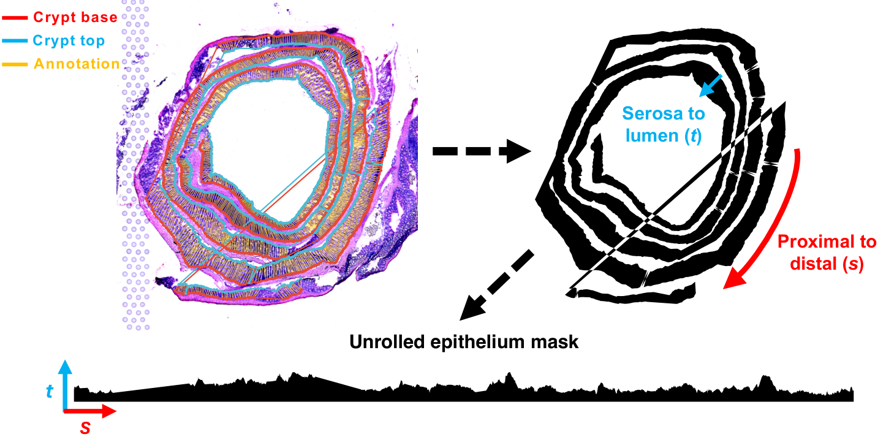

PhD student in Nutritional Sciences

University of Illinois Urbana-Champaign

  <a href="mailto:ruijiez4@illinois.edu">Email</a>
  <a href="https://www.linkedin.com/in/ruijie-jack-zhang/">LinkedIn</a>
  <a href="https://github.com/Jackzzzzzzzzzzzz">GitHub</a>
  <a class="cv-link" href="Jack_Zhang_CV.pdf">CV (PDF)</a>

## About

I study how intestinal epithelial cells maintain tissue function and regulate mucosal immunity. My work combines molecular and cellular biology, bioinformatics, and machine learning to connect gene regulation with cell states and tissue organization. My broader interests include integrating multi-omics data to understand the molecular mechanisms underlying cancer and chronic inflammatory disease.

## Current Research

My doctoral research investigates how the RNA-binding protein hnRNP I (PTBP1) supports intestinal epithelial function and how its loss alters antimicrobial defense and inflammation in the colon. I integrate single-cell and spatial transcriptomics with molecular assays and quantitative tissue imaging to examine epithelial specialization and mucosal organization.

## Selected Project

### Spatial mapping of intestinal epithelial organization

Ongoing research

How does epithelial hnRNP I loss reshape the organization of the colon? I combine tissue annotation, computational unrolling, and single-cell reference mapping to compare epithelial domains and cell-state patterns along anatomical axes. This analysis reveals altered regional epithelial organization and distributions of progenitor-associated signals in knockout tissue.

<figure class="research-figure">
  
  <figcaption><strong>Computational unrolling of colon tissue.</strong> Paired crypt-base and crypt-top annotations define anatomical coordinates for comparing epithelial organization. Select the image to enlarge.</figcaption>
</figure>

## Methods & Expertise

  <h3>Computational biology</h3>
  
Single-cell and spatial transcriptomics; cell-state classification, tissue deconvolution, differential expression, gene regulatory networks, and splice-junction analysis. Statistical modeling and machine learning in R and Python.

  <h3>Molecular &amp; cellular biology</h3>
  
qPCR, Western blotting, chromatin immunoprecipitation (ChIP), and cell and organoid culture to investigate gene regulation and epithelial function.

  <h3>Quantitative tissue imaging</h3>
  
Multiplex immunofluorescence, confocal and epifluorescence microscopy, and quantitative image analysis using Fiji/ImageJ, QuPath, and Python.

## Selected Publications

  <h3><a href="https://doi.org/10.26599/FSHW.2023.9250038">The impact of short-term changes in sleeping and eating patterns on glucometabolic health and gut microbiota in healthy young adults: a proof-of-concept controlled feeding study</a></h3>
  
Jiehua Chen, <strong>Ruijie Zhang</strong>, Chao Zhou, Louise Weiwei Lu, Dana Feng, Haiqiao Zou, Ran Gao, Xinying Zhang, Peiyi Chen, Jiayue Zhu, Haoxie Xu, Nina Zeng, Cijuan Zhang, Bin Liu, Mingfu Wang, Qian Ge, Caiqun Ouyang, Feng Chen.

  
<em>Food Science and Human Wellness</em>, 2024. Co-first author.

  <h3><a href="https://doi.org/10.3390/nu15173747">Consumption of Different Egg-Based Diets Alters Clinical Metabolic and Hematological Parameters in Young, Healthy Men and Women</a></h3>
  
Catherine J. Andersen, Lindsey Huang, Fangyi Zhai, Christa Palancia Esposito, Julia M. Greco, <strong>Ruijie Zhang</strong>, Rachael Woodruff, Allison Sloan, Aaron R. Van Dyke.

  
<em>Nutrients</em>, 2023.

  <h3><a href="https://doi.org/10.1080/10408398.2021.1974335">Missing puzzle pieces of time-restricted-eating (TRE) as a long-term weight-loss strategy in overweight and obese people? A systematic review and meta-analysis of randomized controlled trials</a></h3>
  
Jie-Hua Chen, Louise Weiwei Lu, Qian Ge, Dana Feng, Jianfeng Yu, Bin Liu, <strong>Ruijie Zhang</strong>, Xinying Zhang, Caiqun Ouyang, Feng Chen.

  
<em>Critical Reviews in Food Science and Nutrition</em>, 2023.

